# Phase 1 Benchmark — Pose models

> วันที่วัด: 2026-10-28 · ข้อมูลดิบ: [`data/2026-10-28-builtin-webcam-720p30.json`](data/2026-10-28-builtin-webcam-720p30.json)

## TL;DR

- เลือก **`heavy`** เป็นโมเดลหลัก — นิ่งที่สุด, p95 ต่ำสุด, ช้ากว่า `lite` แค่ ~2 ms ([ADR-0005](../adr/0005-pose-model-heavy.md))
- **One Euro filter ลด jitter ~87%** ในทุกโมเดล (heavy: 4.56 → 0.58 px)
- ทุกโมเดลได้ **30.5 fps = เต็มความเร็วกล้อง** — คอขวดตอนนี้คือกล้อง ไม่ใช่ GPU
- เวลา inference ~14 ms เป็น **ค่าใช้จ่ายคงที่** (ส่งภาพขึ้น GPU / อ่านผลกลับ) ไม่ใช่ขนาดโมเดล

## Setup

| | |
|---|---|
| Machine | Linux, NVIDIA GeForce RTX 4060 Laptop GPU (ANGLE / OpenGL ES 3.2) |
| Browser | Google Chrome 156 |
| Camera | เว็บแคมในตัวโน้ตบุ๊ก "HD Webcam" **1280×720 @ 30 fps** ⚠️ ไม่ใช่กล้องตัวจริง |
| MediaPipe | `@mediapipe/tasks-vision` 1.1.1, models `float16/1`, GPU delegate, `numPoses: 3`, VIDEO mode |
| Filter | One Euro `minCutoff 0.8 · beta 3 · dCutoff 1` (speed in shoulder widths/s) |
| Subject | ผู้ใหญ่ 1 คน ยืนนิ่ง ห่างกล้อง ~2 m เห็นถึงสะโพก, แท็บเดียว (ไม่มีงานอื่นแย่ง GPU) |

## Method

`/?bench` ([`app/src/debug/benchmark.ts`](../../app/src/debug/benchmark.ts)) รันทีละโมเดล: โหลดโมเดลใน worker ใหม่ → ต่อกล้อง → วอร์มอัพ 3 s → วัด 15 s (457 เฟรม/โมเดล) → ปิด worker

| ตัวชี้วัด | นิยาม |
|---|---|
| Inference | เวลา `detectForVideo()` ต่อเฟรมใน worker |
| FPS | จำนวน detection ต่อวินาทีที่ main thread ได้รับ |
| Latency | worker รับเฟรม → ผลถึง main thread (รวม inference) |
| Jitter | ค่าเฉลี่ยการขยับระหว่างเฟรมของ จมูก ไหล่ ข้อมือ (pixel ของภาพกล้อง) — ตอนยืนนิ่ง = การสั่น |
| Coverage | สัดส่วนเฟรมที่เจอคน |

## Results

| Model | Inference avg | p50 | p95 | FPS | Latency avg | Jitter raw | Jitter filtered | Coverage |
|---|---|---|---|---|---|---|---|---|
| lite | 14.9 ms | 14.5 ms | 22.2 ms | 30.5 | 15.0 ms | 5.78 px | 0.77 px | 100% |
| full | 15.6 ms | 15.7 ms | 20.8 ms | 30.5 | 15.7 ms | 5.34 px | 0.71 px | 100% |
| **heavy** | **16.9 ms** | **16.7 ms** | **18.8 ms** | **30.5** | **17.0 ms** | **4.56 px** | **0.58 px** | **100%** |

### Inference time (ms) — งบต่อเฟรมของกล้อง 30 fps = 33.3 ms

```mermaid
xychart-beta
  title "Inference time per frame (ms)"
  x-axis [lite, full, heavy]
  y-axis "ms" 0 --> 35
  bar [22.2, 20.8, 18.8]
  bar [14.9, 15.6, 16.9]
```



แท่งด้านหลัง (สูงกว่า) = p95, แท่งด้านหน้า = ค่าเฉลี่ย

### Jitter while standing still (px)

```mermaid
xychart-beta
  title "Jitter: raw vs One Euro filtered (px)"
  x-axis [lite, full, heavy]
  y-axis "px" 0 --> 6
  bar [5.78, 5.34, 4.56]
  bar [0.77, 0.71, 0.58]
```



แท่งด้านหลัง = ค่าดิบจากโมเดล, แท่งด้านหน้า = หลังกรอง

## Findings

1. **heavy นิ่งกว่าตั้งแต่ต้นทาง** — jitter ดิบต่ำกว่า lite 21% และหลังกรองยังต่ำสุด
2. **p95 ของ heavy ต่ำสุด** (18.8 ms) — เวลาคงที่กว่า ไม่มีเฟรมสะดุด
3. **ขนาดโมเดลแทบไม่มีผลต่อเวลา** (5× ใหญ่กว่า แต่ช้ากว่าแค่ 2 ms) → ~14 ms คือค่าใช้จ่ายคงที่ของ pipeline ถ้าต้องลด latency ในอนาคต ต้องลดตรงนี้ ไม่ใช่เปลี่ยนโมเดล
4. **Worker → main thread แทบไม่มีค่าใช้จ่าย** (latency − inference ≈ 0.1 ms)
5. ยังเหลืองบ ~15 ms/เฟรมที่ 30 fps แต่ถ้าใช้กล้อง **60 fps งบเหลือ 16.7 ms** — heavy p95 18.8 ms จะ **ไม่ทันทุกเฟรม** → ต้องวัดซ้ำกับกล้องจริง

## Observations during testing

- นั่งใกล้กล้องมาก (เห็นแค่หัว/แขน) → **คนเดียวถูกตรวจเป็น 2 pose ซ้อนกัน** → PlayerLock (Phase 2.2) ต้องรวม detection ที่ทับกัน
- Firefox ไม่มี `MediaStreamTrackProcessor` บน window → ใช้ไม่ได้ ([ADR-0006](../adr/0006-kiosk-browser.md))
- ถ้าเปิดหลายแท็บพร้อมกัน inference ช้าลงเกือบเท่าตัว (แย่ง GPU) — วัดทุกครั้งต้องเปิดแท็บเดียว

## Limitations / ต้องวัดซ้ำ

- [ ] กล้องตัวจริง USB 1080p@60 — โดยเฉพาะข้อ 5 (งบ 16.7 ms)
- [ ] Motion-to-photon latency (Phase 1.5) — วัดพร้อมกล้องตัวจริง
- [ ] ความหน่วงของตัวกรองตอนขยับเร็ว (jitter วัดเฉพาะตอนนิ่ง) — Phase 2 ด้วย pose replay
- [ ] ผู้เล่นหลายส่วนสูง / สภาพแสงหน้างาน — Phase 6

## Reproduce

```bash
cd app && pnpm dev
# Chrome, แท็บเดียว: http://localhost:5173/?bench
# ทางเลือก: ?bench=full,heavy&benchSeconds=20
```

กด **Download JSON** แล้วเก็บไว้ใน `docs/benchmarks/data/`
