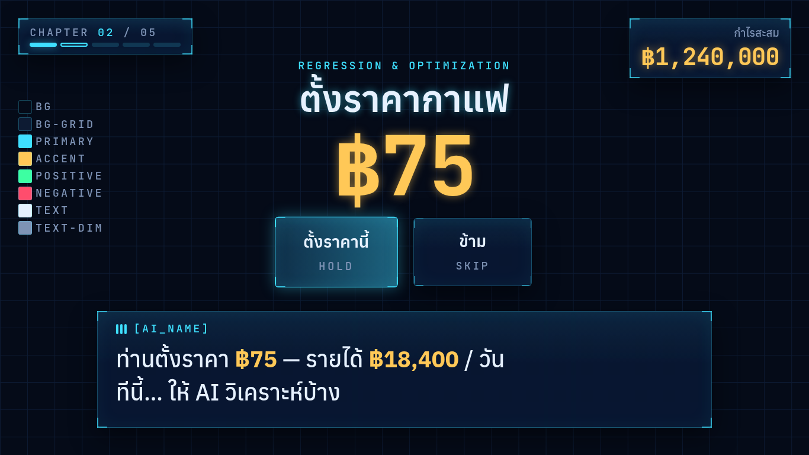

# 011 — Design system ของ HUD: ฟอนต์ ขนาด สี ปุ่ม

- **วันที่:** 2026-10-29 · **สถานะ:** สรุปแล้ว
- **เกี่ยวข้อง:** `app/src/styles/{fonts,tokens,base,hud}.css` · `?styleguide` (`app/src/debug/styleguide.ts`) · ARCHITECTURE §11.3

## คำถาม

1. ฟอนต์ไทยตัวไหนอ่านง่ายที่สุดจากระยะ 2–2.5 m และเข้ากับสไตล์ Holographic HUD
2. ปุ่มที่ชี้ค้าง (dwell) ต้องใหญ่แค่ไหน
3. หน้าตา HUD แบบ "หนังฮีโร่" ควรมีหลักอะไร ไม่ให้แค่สวยแต่ใช้งานไม่ได้

## แหล่งอ้างอิง

| เรื่อง           | แหล่ง                                                                        | ใช้อะไร                                                                         |
| ---------------- | ---------------------------------------------------------------------------- | ------------------------------------------------------------------------------- |
| ขนาดเป้า dwell   | arXiv 2512.16366 (dwell selection, visual angle)                             | เป้า ~4° ของมุมมองดีที่สุด → ที่ 2.5 m ≈ 17.5 cm ≈ 12% ของความกว้างจอ 65"       |
| ปุ่มแบบไม่สัมผัส | Ultraleap TouchFree design guidelines                                        | ปุ่มใหญ่ ห่างกัน ให้ feedback ระหว่างค้าง                                       |
| FUI ในหนัง       | hudsandguis.com (The Avengers), AWN (Age of Ultron), Gizmodo (Iron Man 2 UI) | ทุกชิ้นต้อง "บอกเรื่อง" มีลำดับความสำคัญชัด contrast สูง ชั้นความลึกด้วย motion |
| UX ทั่วไป        | skill ui-ux-pro-max (pattern "Immersive/Interactive Experience")             | มีทางข้ามเสมอ, รองรับ reduced-motion, motion 300–450 ms แบบ stagger, เป้าใหญ่   |

ฟอนต์ที่ skill แนะนำไม่มีภาษาไทย → คัดจาก Google Fonts เฉพาะที่มี Thai: **Anuphan**, **IBM Plex Sans Thai**

## การทดลอง

### รอบที่ 1 — เทียบฟอนต์บนจอจริงขนาด 1920×1080

เรนเดอร์หัวข้อ, บทพูด AI 2 บรรทัด, คำสั่งท่าทาง และตัวเลขเงิน ด้วยสองชุดข้างกัน แล้วย่อภาพเหลือ 1/4 (จำลองการมองจากไกล)

|                 | Anuphan + JetBrains Mono          | IBM Plex Sans Thai + IBM Plex Mono   |
| --------------- | --------------------------------- | ------------------------------------ |
| ความกว้างบรรทัด | แคบกว่า — "…แก้วละ" จบในบรรทัดแรก | กว้างกว่า ~5% — ตัด "ละ" ไปบรรทัดสอง |
| x-height ไทย    | ต่ำกว่าเล็กน้อย                   | สูงกว่า อ่านดูใหญ่กว่านิด            |
| ภาพย่อ 1/4      | อ่านออกทั้งคู่ ไม่ต่างจนมีนัย     | อ่านออก                              |
| บุคลิก          | เรขาคณิต คม เข้ากับ HUD           | ทางการ แบบเอกสาร                     |
| ตัวเลข mono     | 0 มีจุด, แยก 0/O ชัด              | ใกล้เคียง                            |

**เลือก Anuphan + JetBrains Mono** (ตรงกับที่วางไว้ใน ARCHITECTURE): อ่านได้เท่ากัน แต่แคบกว่า → บทพูด ≤ 12 คำ ลง 2 บรรทัดได้ง่ายกว่า และบุคลิกเข้ากับสไตล์ ส่วน x-height ที่ต่ำกว่าชดเชยด้วยขนาดขั้นต่ำ 5 vh

### รอบที่ 2 — ประกอบเป็นหน้าจอจริง (`?styleguide`)

จัดชิ้นส่วนทั้งหมดเหมือนฉากราคากาแฟ แล้วถ่ายที่ 1920×1080 และ 1366×768

ปัญหาที่เจอ → แก้

| เจอ                                                                                    | แก้                                                                         |
| -------------------------------------------------------------------------------------- | --------------------------------------------------------------------------- |
| label "กำไรสะสม" ใช้ letter-spacing + uppercase แบบ mono → สระ/วรรณยุกต์ห่างกันอ่านยาก | แยก `.hud-label-th` (ไม่มี tracking); `.hud-label` ใช้กับภาษาอังกฤษเท่านั้น |
| ปุ่มทับกล่องบทพูด                                                                      | กติกา layout: **เป้าที่กดได้ห้ามอยู่ในโซนบทพูด** (ล่าง ~30% ของจอ)          |
| กล่องบทพูดกว้างเกิน เหลือที่ว่างขวามาก                                                 | `min(76vw, 140vh)` — ยังกว้างคงที่ ไม่กระโดดตอน typewriter พิมพ์            |

ทั้งสองความละเอียดได้สัดส่วนเดียวกัน (ทุกขนาดเป็น vh)

## ข้อสรุป — design system

- **สี:** ตาม ARCHITECTURE §11.3 + `--bg-deep`, `--panel-strong`, `--line`, `--line-strong`; text-dim บนพื้นได้ contrast ~6:1 (ผ่าน 4.5:1)
- **ตัวอักษร:** hero 18 vh / display 11 / headline 8 / caption 5 (ขั้นต่ำของข้อความ AI) / label 3.5 / micro 2.4 · line-height ไทย ≥ 1.45
- **Panel:** กระจก (blur 12px) + เส้นขอบจาง + มุมวงเล็บเรืองแสง (ลายเซ็นของ HUD)
- **ปุ่ม dwell:** ขั้นต่ำ 26 × 15 vh (≈ 14% × 15% ของจอ 16:9 ≥ เป้า 4°) · ระหว่างค้าง **ตัวปุ่มเองเติมแสงจากซ้ายไปขวา** (feedback ที่ปุ่ม ไม่ใช่แค่ที่ cursor) · ชี้แล้วขยาย 4% + เรืองแสง · เลือกแล้วแฟลชสีทอง
- **Motion:** เข้า expo.out / ออก power2.in · 200 / 500 / 1200 ms · `prefers-reduced-motion` ย่อเวลา · ไฟ "กำลังพูด" เคลื่อน 0.55 รอบ/วินาที (ต่ำกว่าเกณฑ์ 3 ครั้ง/วินาที)

## ข้อจำกัด / ต้องทดสอบต่อ

- ยังไม่ได้ดูบนทีวีจริงที่ระยะ 2.5 m — ทำตอน playtest (Phase 6)
- `backdrop-filter: blur` ทับ WebGL มีต้นทุน GPU ทุกเฟรม → วัดใน PR renderer (3.2)
