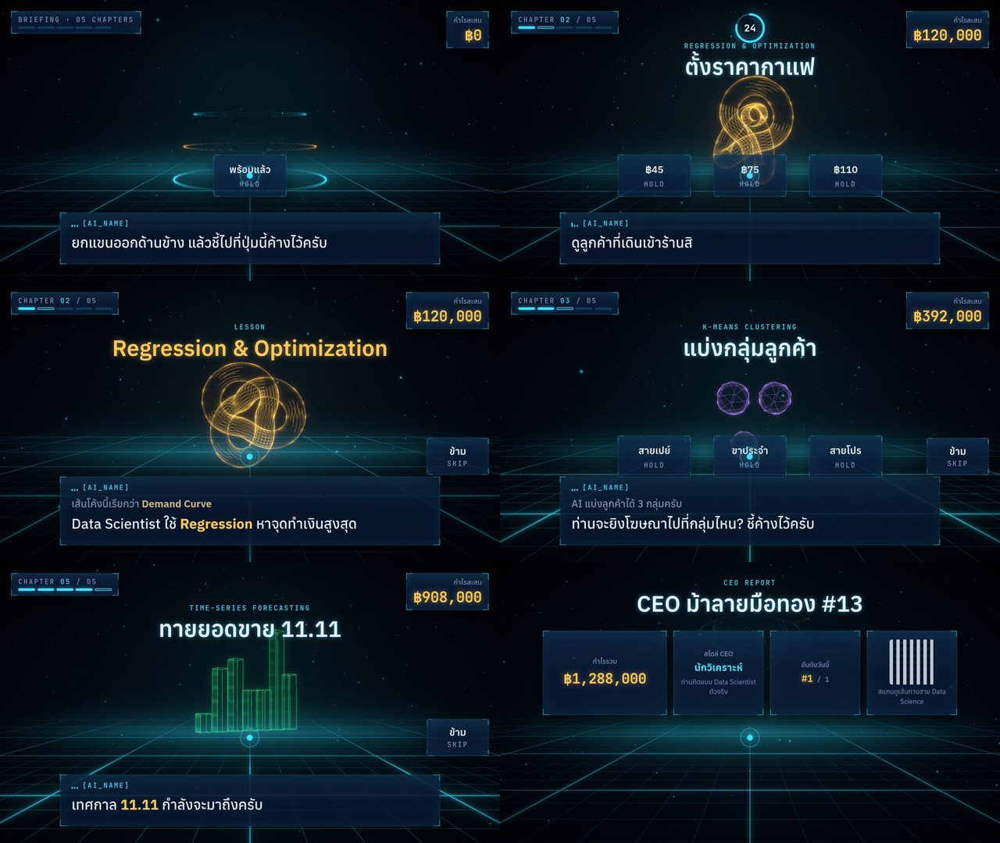

# 013 — ประกอบทั้งรอบ: layout ของฉาก, HUD และการทดสอบ flow

- **วันที่:** 2026-10-29 · **สถานะ:** สรุปแล้ว
- **เกี่ยวข้อง:** `app/src/experience/` · `app/src/hud/*` · `app/src/scenes/*` · PR #39

## คำถาม

เอาทุกชิ้น (state machine, narrative, scene, HUD, input) มาต่อกันแล้ว เล่นได้ครบรอบไหม และหน้าจอแต่ละจังหวะอ่านง่าย ไม่ทับกันไหม

## วิธีทดสอบ

Playwright + Chrome (GPU จริง) เปิด `/?speed=4` → กด F2 (โหมดเมาส์ = มีคนเข้ามา) → สคริปต์ถ่ายภาพทุกครั้งที่ phase/chapter/beat เปลี่ยน และคลิกปุ่มที่โผล่มา (คลิก = select เหมือน dwell) → วนจนกลับ attract
**ไม่เปิดกล้องจริง** — headless ปฏิเสธสิทธิ์กล้อง (log `NotAllowedError`)

## รอบที่ 1 — ครบรอบไหม

attract → welcome → 5 บท (mission/tutorial/play/reveal/lesson) → report → attract **ครบใน 66 วินาที** (×4) ไม่มี error ใน console · 60 fps (median 16.7 / p95 16.8 ms)

## รอบที่ 2 — ดูทีละภาพ: เจอ 7 ปัญหา

| เจอ                                                                                        | แก้                                               |
| ------------------------------------------------------------------------------------------ | ------------------------------------------------- |
| ปุ่ม "ข้าม" ทับมุมขวากล่องบทพูด                                                            | ย้ายขึ้นไปขอบขวาเหนือกล่อง (bottom 33 vh)         |
| กรอบ mini-skeleton ว่างเปล่าตอนไม่มีร่างกาย (โหมดเมาส์)                                    | ซ่อนเมื่อไม่มี pose — กรอบว่างดูเหมือน "ระบบเสีย" |
| ตอน welcome ขึ้น "CHAPTER 00 / 05"                                                         | "BRIEFING · 05 CHAPTERS"                          |
| hologram ของบททับชื่อบท                                                                    | ลดขนาด (0.75×) และย้ายลงกลางจอ (world y 0.95)     |
| eyebrow "LESSON · สิ่งที่ท่านเพิ่งทำ" — ภาษาไทยใน label mono ถูก tracking แตก (ซ้ำกับ 011) | ใช้ "LESSON" อย่างเดียว                           |
| ตัวเลขกำไรรวมใน report ล้นการ์ด                                                            | การ์ดกำไรกว้าง 44 vh + `nowrap`                   |
| ปุ่มตัวเลือกบัง hologram ส่วนบน                                                            | เลื่อนแถวปุ่มลง (top 55 vh) — ยังเหนือโซนบทพูด    |

รอบ 3 (หลังแก้): ถ่ายทั้งรอบใหม่ ไม่เหลือจุดทับ

## การตัดสินใจ

- **Crossfade โดยไม่ใช้ render target** (ต่างจาก ARCHITECTURE §5.10): วัสดุ hologram เป็น additive ทั้งหมด → ฉากเก่าจางออกพร้อมฉากใหม่จางเข้าใน scene เดียวกัน ได้ภาพเหมือนกันโดยไม่ต้องเรนเดอร์ 2 รอบ; ถ้าฉากจริงใน Phase 4 มีวัสดุทึบ ค่อยเพิ่ม render target
- **ปุ่มของฉากที่กำลังออกถูก `inert`** → เลิกเป็นเป้า dwell ทันที (ไม่มีการกดปุ่มที่กำลังหายไป)
- **Typewriter ไม่ทำให้บรรทัดกระโดด**: ตัวที่ยังไม่พิมพ์ถูกวางไว้แต่ซ่อน (`visibility: hidden`)
- **บรรทัดก่อนหน้าค้างไว้เล็กและจาง** ให้มีบริบท — ไม่เกิน 2 บรรทัด
- Placeholder ทุกบทมีตัวเลือก 1–3 ปุ่มใน play (เลือกแล้วจบ play) → ทั้งรอบเล่นด้วยร่างกายได้จริง; ตัวเลข "น้องคือข้อมูล" นับจาก pose ที่ได้รับจริง × 99

## ข้อจำกัด / ต่อ

- Tutorial ของท่าอื่น (raise/throw/slap/draw) ยังไม่มี detector → รอ timeout 8 s (Phase 4)
- ยังไม่ได้ลองด้วยร่างกายจริง → E2E ด้วยผู้เล่นสังเคราะห์ (PR ถัดไป) แล้วค่อย playtest
