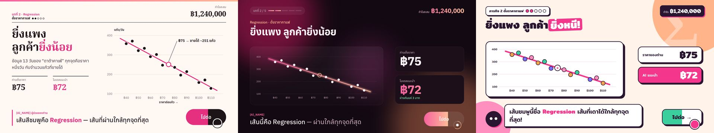
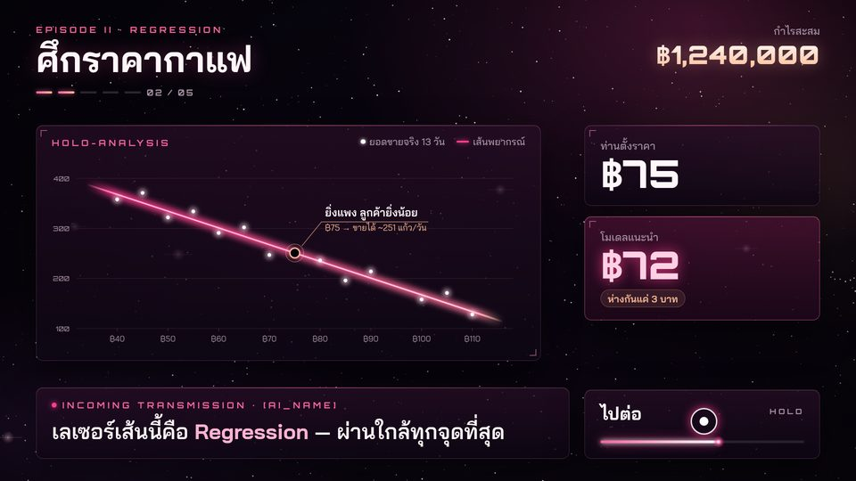
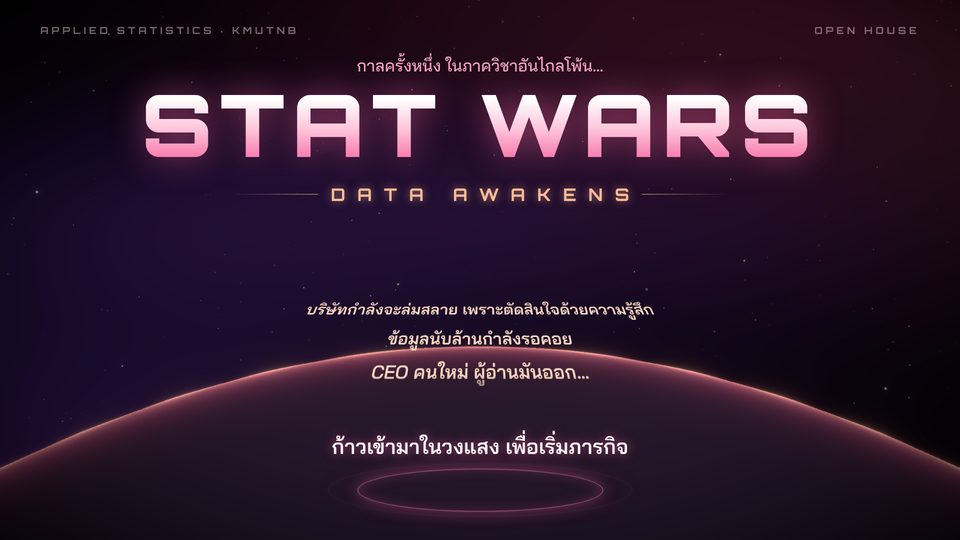
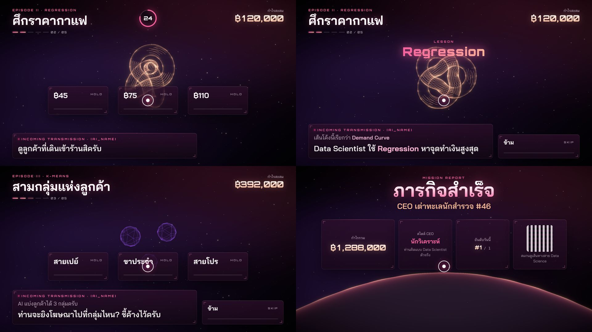

# 016 — ดีไซน์ใหม่ "STAT WARS": จาก mockup 4 แนวสู่ design system

- **วันที่:** 2026-10-29 · **สถานะ:** สรุปแล้ว
- **เกี่ยวข้อง:** `app/src/styles/*` · `app/src/render/stage.ts` · `app/src/config/palette.ts` · `app/src/hud/*` · `content/story.th.yaml`

## โจทย์ (จากเจ้าของงานหลังดู v0.3.0)

- "ไม่ชอบ มันเหมือน AI ลองทำดีไซน์ให้สวยกว่านี้"
- สีของภาควิชาสถิติประยุกต์ (ชมพู) — อ้างอิงเว็บ stat.sci.kmutnb.ac.th
- ธีมงาน **STAT Wars**

## สีของภาควิชา (ดึงจากภาพหน้าเว็บ)

แถบหัวเว็บไล่ `#F6629E` → `#FEBB97` · โลโก้ Σ magenta `#F4378D` + ส้ม `#EEA24E`

## รอบที่ 1 — mockup 3 แนว (ฉากเดียวกัน: เฉลยราคากาแฟ)

A Editorial (ครีม, ตัวมีเชิง) · B Premium keynote (ม่วงเข้ม, แสงนุ่ม) · C Bold & Playful (สติกเกอร์, เส้นหนา)
อ้างอิง: Giorgia Lupi/Pentagram "Telling My Story Through Data" (สีสด เป็นมนุษย์ สำหรับเด็ก), MDPI 2025 (เด็กกับสื่อควบคุมด้วยท่าทาง: เล่นและค้นพบร่วมกัน), data.europa.eu (ติดป้ายข้อสรุปบนเส้นแนวโน้ม)
ทุกแนวตัดสิ่งที่ทำให้ "ดูเหมือน AI": เรืองแสงฟ้า, มุมวงเล็บ, ตัว mono พิมพ์ใหญ่ห่าง ๆ

ปัญหาที่เจอระหว่างทำ: ตั้งชื่อฟอนต์ว่า `Serif` → CSS ตีความเป็น generic `serif` (ไม่โหลดฟอนต์จริง) · ข้อมูลตัวอย่างเรียงเป็นเส้นตรงเกินจนดูปลอม → ใส่ noise

## รอบที่ 2 — เจ้าของงานขอแนวที่ 4: "เท่ ๆ" ธีม STAT Wars

D v1: อวกาศ, โลโก้เส้นเรืองแสง, ข้อความเลื่อนเอียง, เส้น regression เป็นดาบแสงมีด้าม — แรงบันดาลใจจาก space opera แต่**ออกแบบเองทั้งหมด** ไม่ใช้โลโก้/ฟอนต์/ตัวละครของ Star Wars (repo สาธารณะ)
เจ้าของงาน: "ชอบแบบ D แต่ขอสวยอีก ไม่ต้องเบียวเอาดาบ ทำเป็นเลเซอร์ปกติ"

## รอบที่ 3 — D v2 (เลือก)

เลเซอร์ปกติ (แกนขาว + เรืองชมพู จางที่ปลาย), ป้ายข้อสรุปบนเส้น, กรอบมุมมนเล็ก + เส้นแสงขอบบน + ขีดมุม 2 มุม, ดาว 2 ชั้น + เนบิวลานุ่ม + ขอบดาวเคราะห์ → **"ถูกใจ"**

## รอบที่ 4 — ทำเป็นระบบจริง: เจออะไรบ้าง

| เจอ                                                                                                                 | แก้                                                                                                                     |
| ------------------------------------------------------------------------------------------------------------------- | ----------------------------------------------------------------------------------------------------------------------- |
| Orbitron **ไม่มีตัวเลขกว้างเท่ากัน**: "111111" 235 px vs "888888" 500 px, `tabular-nums` ไม่มีผล → ตัวนับกำไรจะสั่น | `hud/digits.ts` วางตัวเลขในช่องกว้างคงที่ (0.78em; คั่น 0.34em; ฿ 0.62em) อัปเดตเฉพาะช่องที่เปลี่ยน                     |
| เนบิวลาจาก value-noise: สว่างเกินและมี**ขอบแข็งเป็นก้อน** (bloom ขยาย)                                              | เปลี่ยนเป็นแสง gaussian นุ่ม 5 ก้อนลอยช้า ๆ (แบบเดียวกับ mockup) — ไม่มีขอบแข็งได้โดยโครงสร้าง                          |
| ดาวเคราะห์สว่างทั้งลูก: กล้องมองจากมุมเฉียง → `1 − N·V` สูงทั่วผิว                                                  | rim ยกกำลัง 14 + เปลือกบรรยากาศ back-face แยก; ขอบฟ้าลดลง                                                               |
| ตัวไทยโดน letter-spacing ของ Orbitron (`กาลครั้งหนึ่ง…`, `กำไรสะสม`, `ภารกิจสำเร็จ`)                                | กติกาเดิม (011): tracking ใช้กับละตินเท่านั้น — ไล่แก้ทุกจุด                                                            |
| layout ใหม่: กล่องบทพูดชิดซ้ายล่าง → ปุ่มข้ามย้ายไปขวาล่าง, mini skeleton ไปใต้กำไร                                 | ไม่มีอะไรทับกัน (ดูภาพทั้งรอบ)                                                                                          |
| ปุ่มตัวเลือกดูเล็กเมื่อเทียบกับฉาก                                                                                  | ตัวเลือก 36 × 17 vh, ตัวอักษร 4.4 vh                                                                                    |
| Console: `CONTEXT_LOST_WEBGL: loseContext` ในหน้า experience                                                        | ดักทุกการเรียก `loseContext` ในหน้า → ไม่มีโค้ดของเราเรียก; มาจาก canvas ทดสอบ GPU ของสคริปต์วัดผลเอง — แอป 60 fps ปกติ |

## ผล

- ฟอนต์: **Bai Jamjuree** (ไทย/UI) + **Orbitron** (หัวข้ออังกฤษ/ตัวเลข) แทน Anuphan + JetBrains Mono
- palette กลาง `config/palette.ts` ใช้ร่วมกันใน WebGL/canvas; CSS tokens ค่าเดียวกัน
- เนื้อเรื่องตามธีม: EPISODE I–V, attract = STAT WARS / DATA AWAKENS + opening crawl, รายงานตอนจบ = "ภารกิจสำเร็จ"
- 60 fps (median 16.7 / p95 16.7 ms ที่ 1080p), unit 216, E2E 4/4

## ข้อจำกัด

- ฉากในบทยังเป็น placeholder — บท Regression จริงเป็นงานถัดไป
- หน้า `?styleguide` (เครื่องมือ debug) ยังเป็นเลย์เอาต์เก่าที่ใช้ token ใหม่
