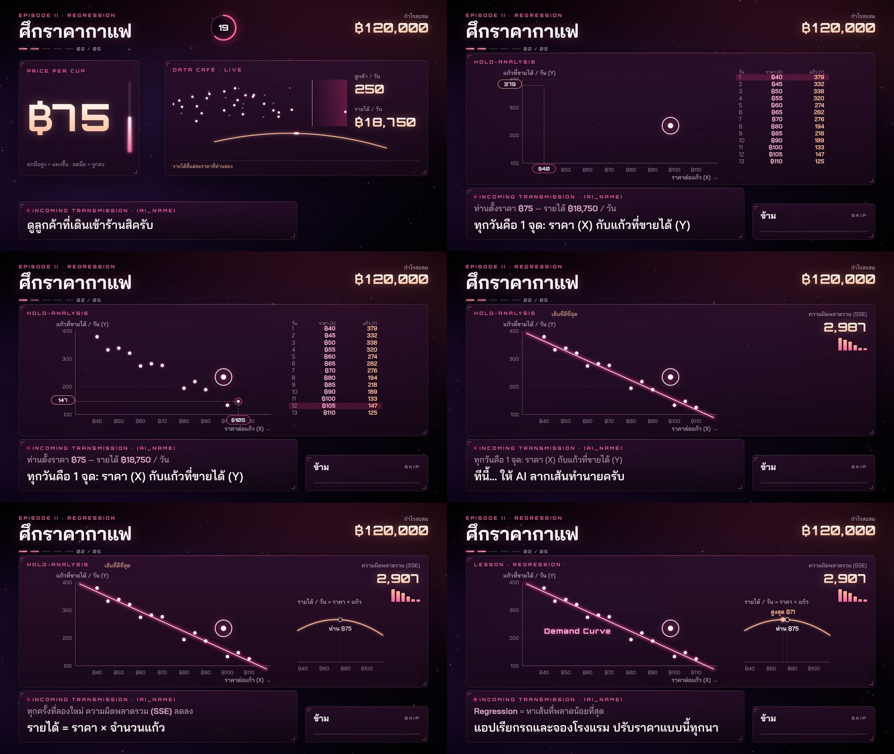

# 017 — EPISODE II ศึกราคากาแฟ: Regression ที่เล่าด้วยภาพ

- **วันที่:** 2026-10-29 · **สถานะ:** สรุปแล้ว (รอลองด้วยร่างกายจริง)
- **เกี่ยวข้อง:** `app/src/scenes/coffee/*` · `app/src/gestures/raise.ts` · `app/src/viz/animator.ts` · `content/story.th.yaml` · `tests/e2e/caption-fit.spec.ts`

## โจทย์ (เจ้าของงาน)

"Regression ก็ลองยกตัวอย่างข้อมูล ชู Y แล้ว Y วิ่งเข้ากราฟ ชู X แล้ว X วิ่งเข้ากราฟ ลากเส้นพยากรณ์ มีแบบลากครั้งที่ 1 แล้ว… สร้าง animation มากกว่านี้ ทำให้ดีและละเอียด"

## สิ่งที่สร้าง

**ตอนเล่น (30 s):** ยกมือ = ราคา (฿30–120) · ลูกค้าเดินเข้า "ดาต้าคาเฟ่" ตามอุปสงค์จริง (ราคาสูง = หันหลังกลับมากขึ้น) · ตัวเลข ลูกค้า/วัน และ รายได้/วัน · **เส้นรายได้ของทุกราคาที่ลอง** — ผู้เล่นเห็นยอดภูเขาเองระหว่างหา
**ตอนเฉลย (≈ 44 s ที่ความเร็วจริง)** ตาม storyboard ที่อนุมัติ:

1. แกน X/Y ลากออกจากมุม ตาราง 13 วันเลื่อนเข้า
2. ทุกวัน: แถวสว่าง → ค่า **X บินโค้งไปปักแกนราคา** · ค่า **Y บินไปปักแกนแก้ว** → เส้นฉายจากสองแกนมาบรรจบ → ดาวจุดติดพร้อมวงแสง (3 วันแรกช้า ที่เหลือเร็ว)
3. AI ลากเส้น: เริ่มจากเส้นแบนผิด ๆ → เส้นประ error จากทุกดาว → **SSE 246,153 → 105,678 → 46,328 → 10,658 → 3,154 → 2,907** (กราฟแท่งเล็กโชว์ทีละครั้ง, log scale) → ล็อกพร้อมแสงวาบ
4. รายได้ = ราคา × แก้ว วาดเป็นโค้งในกรอบของตัวเอง (**ไม่ใช้แกน y ซ้อน**) → หมุด "สูงสุด ฿71" กับ "ท่าน ฿{price}"
5. บทเรียน: ป้าย "Demand Curve" บนกราฟ, หัวกรอบเป็น LESSON · REGRESSION

**ทุกตัวเลขคำนวณจริง:** ข้อมูล 13 วันสุ่มแบบ seed คงที่จากอุปสงค์ `520 − 3.6·ราคา` + noise · เส้น = least squares · แต่ละครั้งที่ลอง = gradient descent จริง (ทดสอบว่า SSE ลดทุกครั้งและจบที่ least squares) · ราคาดีที่สุด = −a/2b (unit test 5)

## การทดลอง / ปัญหาที่เจอ

| รอบ | เจอ                                                                                                                                                                 | แก้                                                                                                                      |
| --- | ------------------------------------------------------------------------------------------------------------------------------------------------------------------- | ------------------------------------------------------------------------------------------------------------------------ |
| 1   | ทั้งลำดับเล่นได้ แต่ตัวอักษรในกราฟเล็ก (17 px บนจอ) และกราฟใช้แค่ ~60% ของกรอบ (SVG ย่อตามความสูง)                                                                  | viewBox ใหม่ 1800×600 ให้ตรงสัดส่วนกรอบ, ตัวอักษร 27–30 หน่วย, กรอบสูงขึ้น                                               |
| 1   | ป้าย "สูงสุด ฿71" กับ "ท่าน ฿75" ทับกัน (ราคาใกล้กัน)                                                                                                               | ป้ายยอดอยู่เหนือโค้งเสมอ ป้ายผู้เล่นอยู่ใต้เสมอ                                                                          |
| 1   | เส้นรายได้ตอนเล่นแบน มองไม่เห็นยอด                                                                                                                                  | ซูมแกนรายได้เฉพาะช่วงที่เกิดจริง                                                                                         |
| 2   | บทพูด 2 บรรทัดดันกล่องขึ้นไปทับกราฟ — กฎ "≤ 52 ตัวอักษร" วัดตอนกล่องกว้าง 76 vw ตอนนี้ 62 vw และฟอนต์ใหม่                                                           | **E2E ใหม่วัดทุกบรรทัดในกล่องจริง** (ฟอนต์จริง ตัวหนาจริง ค่าตัวแปรยาวที่สุดที่สมจริง) ≤ 92% → ย่อ 2 บรรทัด              |
| 2   | ตัวนับ SSE ทับตาราง · "เส้นที่ดีที่สุด" ทับชื่อแกน · กรอบชนแถบความคืบหน้า · ป้าย Demand Curve ทับจุด                                                                | ซ่อนตารางก่อนลากเส้น, ย้ายป้ายและกรอบ                                                                                    |
| 3   | E2E: ปุ่มเดียวของบทถัดไปโผล่**ใต้มือที่ยังยกค้าง** แล้วชี้ค้างเท่าไรก็ไม่ติด — กฎ 014 รอให้ cursor ออกจากปุ่มก่อน ซึ่งเป็น**กับดัก**สำหรับคนจริง (ยกมือมาจากบทกาแฟ) | ปุ่มที่โผล่ใต้มือกลับมาใช้ได้เมื่อ cursor ออก **หรือเล็งใหม่ ≥ 5% ของจอ** + unit test; test ให้ลดแขนหลังเลือก (เหมือนคน) |

ระหว่างทั้งตอนเฉลย: **60 fps** (median 16.7 / p95 ≤ 16.8 ms, วัด 12 ช่วง) แม้มี SVG filter เรืองแสงหลายชั้น

## ส่วนประกอบใหม่ที่ใช้ซ้ำได้

- `RaiseDetector`: ข้อมือข้างที่สูงกว่า เทียบสะโพก (0.3 → 2.6 SW = 0 → 1) + smoothing 120 ms; เมาส์ (F2) ใช้ความสูง pointer แทน
- `Animator`: tween แบบเดินตามเวลาเฟรม — pause แล้วหยุดกลาง animation, `?speed` เร่งได้, เขียนลำดับแบบ `await`
- `SceneModule.showCursor()` (ซ่อน cursor ระหว่างใช้มือทำอย่างอื่น), `ownsLesson()`

## ข้อจำกัด / ต่อ

- ยังไม่ได้ลองยกมือจริงหน้ากล้อง: ช่วง 0.3–2.6 SW และความนุ่ม 120 ms ต้องดูตอนลองสด
- ลูกค้าเป็นจุด 2D — อาจเพิ่มรูปแก้วกาแฟ/ร้านทีหลัง
- บทอื่นยังเป็น placeholder (K-means ต่อไปตาม storyboard ของเจ้าของงาน: จัดกลุ่มผิด → SSE สูง → ใหม่ → Elbow)
