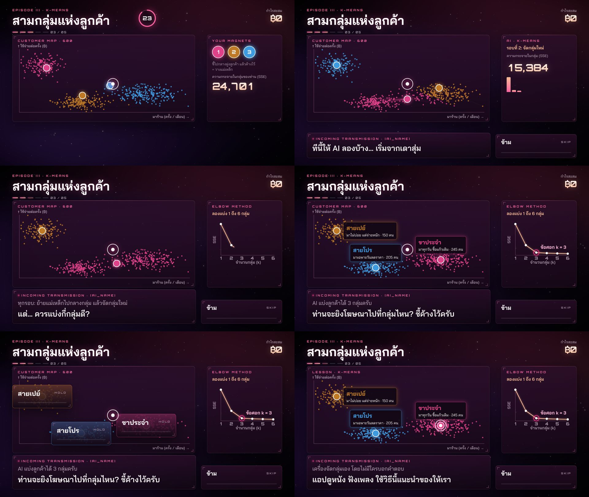

# 018 — EPISODE III สามกลุ่มแห่งลูกค้า: K-means ที่เห็นทุกขั้น

- **วันที่:** 2026-10-29 · **สถานะ:** สรุปแล้ว (รอลองด้วยร่างกายจริง)
- **เกี่ยวข้อง:** `app/src/scenes/segments/*` · `content/story.th.yaml` · `app/vite.config.ts`

## โจทย์ (เจ้าของงาน)

"kmean แสดง scatter มีการจัดกลุ่ม ตอนแรกจัดผิด SSE สูง ใหม่ ใหม่ ใหม่ จน SSE ลดลง (Elbow method)"

## สิ่งที่สร้าง

- **ข้อมูล:** ลูกค้า 600 คน (seed คงที่) แกน X = มาร้านกี่ครั้ง/เดือน, Y = จ่ายต่อครั้ง; ซ่อน 3 กลุ่มจริง (สายเปย์ 150, ขาประจำ 250, สายโปร 200)
- **ตอนเล่น:** ชี้ค้างกลางฝูง 0.9 s = วางแม่เหล็ก (3 ลูก) — ทุกจุดเปลี่ยนสีตามแม่เหล็กที่ใกล้สุด, เส้นเชื่อมจางลง, เห็น SSE ของการจัดกลุ่มตัวเองทันที; หมดเวลาแล้ววางให้เอง
  - ใช้ "ชี้ค้าง" แทน "ขว้าง" ตาม STORY: ยังไม่มี detector ท่าขว้าง และชี้ค้างแม่นกว่ามากสำหรับวางตำแหน่ง
- **ตอนเฉลย:** AI เดาสุ่ม (แม่เหล็กเรียงที่ขอบขวา) → ทุกรอบ "ย้ายแม่เหล็กไปกลางกลุ่ม" แล้ว "จัดกลุ่มใหม่" → SSE (×1000) 171,465 → 23,786 → 15,384 → 7,271 → 6,541 พร้อมกราฟแท่งทีละรอบ → "นิ่งแล้ว" + เทียบ SSE ของผู้เล่น
- **Elbow:** ลอง k = 1…6 แผนที่จัดกลุ่มใหม่ทุก k ขณะเส้นกราฟวิ่งไปทีละจุด → วงที่ "ข้อศอก k = 3"
- **ตั้งชื่อกลุ่ม** ติดป้ายบนแผนที่ → **ป้ายกลายเป็นปุ่ม**: ชี้ไปที่กลุ่มบนแผนที่เพื่อเลือกยิงโฆษณา

## การทดลอง / ปัญหาที่เจอ

| เจอ                                                                                                                                                      | ทำอะไร                                                                                                                                                                                        |
| -------------------------------------------------------------------------------------------------------------------------------------------------------- | --------------------------------------------------------------------------------------------------------------------------------------------------------------------------------------------- |
| unit test: เริ่มจากแม่เหล็กกองที่มุม → K-means **ติด local minimum** (แบ่งขาประจำเป็น 2 กลุ่ม รวมสายโปรเข้าไป)                                           | ทดลองจุดเริ่ม "ผิดชัด ๆ" 6 แบบ วัดจำนวนรอบ, SSE ทุกรอบ และผลลัพธ์ถูกไหม → เลือก "เรียงขอบขวา": ผิดชัดแต่ถูกใน 6 รอบ ลดเป็นขั้นบันไดสวยที่สุด (test ล็อกไว้)                                   |
| ตัวเลือก elbow แบบ second difference เลือก **k = 2** (ช่วงลดแรกใหญ่จนบังส่วนที่เหลือ)                                                                    | ใช้กฎ **Kneedle** (จุดที่ต่ำกว่าเส้นตรงจากปลายถึงปลายมากที่สุดบนกราฟ normalize) → k = 3; test ล็อกไว้                                                                                         |
| สี 3 กลุ่มชุดแรก (ชมพู/พีช/ม่วงอ่อน) ตก lightness band ของโหมดมืด                                                                                        | ใช้ validator ของ skill dataviz ลองหลายชุด → `#E0428A` `#C07A26` `#3F9BE0`: ผ่านทุกข้อ (CVD ΔE 11.5, contrast ≥ 3:1, L 0.48–0.67)                                                             |
| ตอนเฉลยข้าม AI วนรอบกับ Elbow ไปเลย                                                                                                                      | ใส่ log: cue แรกคือ `clusters` = **dev server เสิร์ฟ story เก่า** — Vite ไม่ตามไฟล์นอก root (`../content`) → plugin ตามโฟลเดอร์ content แล้ว reload (E2E ไม่เจอเพราะเปิด server ใหม่ทุกครั้ง) |
| ป้ายกลุ่มบนทับหัวกรอบ → ย้ายลงล่างแล้วทับป้ายอีกกลุ่ม · ปุ่ม "ขาประจำ" ขึ้น 2 บรรทัด · ป้ายข้อศอกทับเส้น · เส้น elbow ช่วงแรกหาย (dash offset เกิน 100%) | ป้ายกลุ่มบนไปด้านข้าง, `nowrap`, ย้ายป้าย, clamp offset                                                                                                                                       |
| E2E หาปุ่มด้วย `.hud-choices` → ไม่เจอปุ่มบนแผนที่                                                                                                       | หาจากปุ่มที่เป็นเป้าในฉากปัจจุบัน (`[data-target]`)                                                                                                                                           |

ตลอดบท **60 fps** (p95 ≤ 16.8 ms, 600 จุด + เส้นเชื่อมบน canvas)

## อื่น ๆ

- `?chapter=segments` (นักพัฒนา/รีวิว): เริ่มที่บทนั้นทันทีหลังเข้ามา
- คะแนน: 50% จากความใกล้ของการวางแม่เหล็กกับคำตอบ (SSE ดีที่สุด / SSE ผู้เล่น) + 50% จากกลุ่มที่เลือกยิงโฆษณา

## ข้อจำกัด

- ยอดเพิ่ม (lift) ของแต่ละกลุ่มเป็นค่าจำลอง
- ยังไม่ได้ลองวางแม่เหล็กด้วยร่างกายจริง (ชี้ค้าง 0.9 s, รัศมีนิ่ง 3% ของจอ)
